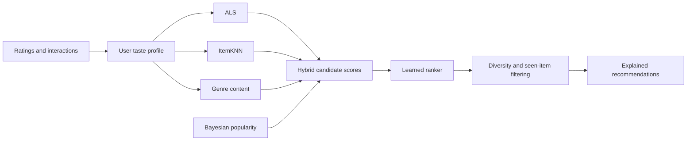

# Intelligent Hybrid Movie Recommendation System

**Author:** Rohit Ahirwar<br>
**Stack:** Python, FastAPI, scikit-learn, implicit ALS, React, Vite, SQLite/PostgreSQL

A full-stack recommendation system that learns from a user's ratings, likes, and watchlist, then combines collaborative filtering, movie metadata, popularity signals, and a learned ranker to produce personalized movie suggestions.

## What it does

- Builds recommendations from collaborative and content-based signals.
- Blends ALS, ItemKNN, genre affinity, and Bayesian-smoothed popularity.
- Re-ranks candidates with a HistGradientBoosting model.
- Updates the user's taste profile as they interact with titles.
- Shows why a title was suggested and lets users dismiss recommendations.
- Supports new-user onboarding, genre search, ratings, likes, and watchlists.
- Provides a React interface and a FastAPI service.

## Recommendation flow



## Offline evaluation

The following results were recorded on a held-out MovieLens test set. They measure offline ranking quality; they are not a claim of improved engagement in a live streaming service.

| Model | NDCG@10 | Hit Rate@10 | Precision@10 | Recall@10 |
|---|---:|---:|---:|---:|
| Hybrid + learned ranker | **0.1036** | **0.398** | **0.0638** | **0.110** |
| Tuned hybrid | 0.0982 | 0.390 | 0.0623 | 0.105 |
| ALS | 0.0916 | 0.372 | 0.0589 | 0.098 |
| Content-based | 0.0585 | 0.286 | 0.0406 | 0.062 |

The ranker improved NDCG@10 by about 5.5% relative to the tuned hybrid on this test set. Experiment outputs are in [`docs/results`](docs/results/).

## Run locally

### Requirements

- Python 3.11 or later
- Node.js 18 or later and npm
- MovieLens 25M data (downloaded by the project script; the raw dataset is not stored in this repository)

### 1. Install and prepare data

From the repository root:

```powershell
python -m venv .venv
.venv\Scripts\Activate.ps1
python -m pip install -r requirements.txt
python scripts/download_data.py
python scripts/preprocess.py
```

On macOS/Linux, activate with `source .venv/bin/activate`.

### 2. Start the API

```powershell
uvicorn src.api.main:app --reload --host 127.0.0.1 --port 8000
```

The interactive API documentation is available at `http://localhost:8000/docs`.

### 3. Start the frontend

In a second terminal:

```powershell
cd app/frontend
npm install
npm run dev
```

Open the local address printed by Vite (normally `http://localhost:3000`). Create an account, rate or like a few movies, and watch the recommendation section update. A **Not for me** action records negative feedback.

The checked-in repository does not contain trained model artifacts. Without them, the service uses its available content/popularity fallback. To train the models, run these from the project root after preparing MovieLens:

```powershell
python scripts/train_cf_model.py
python scripts/train_hybrid.py
python scripts/train_ranker.py
```

Training time and memory use depend on the machine. The scripts save model files under `models/`, which is excluded from Git.

## Repository structure

```text
src/
  api/             FastAPI routes, schemas, persistence, recommendation service
  data/            MovieLens loading, cleaning, and preprocessing
  features/        Interaction and content features
  models/          Popularity, content, collaborative, and hybrid models
  ranking/         Ranker and ranking feature construction
  recommendations/ Cold start, profiles, diversity, exploration, explanations
scripts/           Data preparation, training, and demo utilities
tests/             Unit tests
app/frontend/      React and Vite client
docs/results/      Saved offline evaluation results
```

## Data and project scope

Training and evaluation use MovieLens 25M, an offline movie-ratings dataset. The interactive app records feedback from its own users. The project does not access a streaming platform's private watch history or alter an external platform's recommendation feed. TV-series coverage is limited to whatever titles are present in the movie catalog.

MovieLens data is provided by [GroupLens](https://grouplens.org/datasets/movielens/25m/) for research use and is not included here. Review the dataset terms before using it. No source-code license is currently included in this repository.

## Project notes

- API routes are mounted under `/api`.
- The default local database is SQLite; PostgreSQL settings are available for Docker-based development.
- Raw data, processed data, local databases, credentials, and trained model artifacts are excluded from Git.
- See [`docs/architecture.md`](docs/architecture.md) for additional design details.
